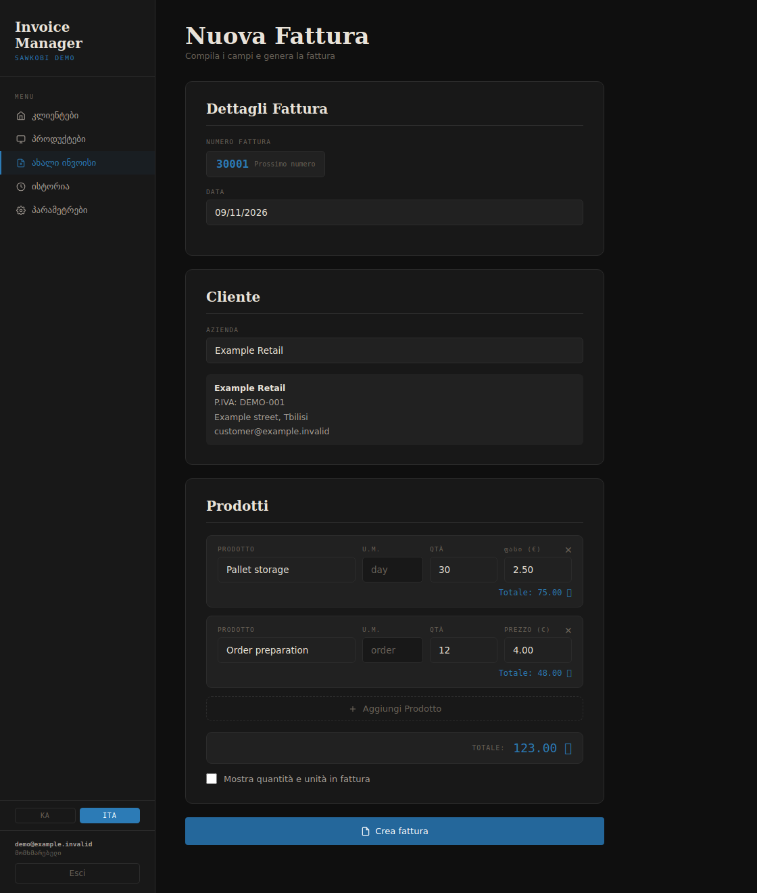

# Invoice Manager

**A side project I built for fun for [Sawkobi.ge](https://sawkobi.ge), turning a full day of invoice preparation into about two hours.**

Sawkobi is a third-party logistics company in Georgia. Preparing invoices meant repeatedly entering customer details, calculating service charges, formatting documents and sending them out. I built this app to bring that workflow into one place: choose a customer, add services, preview a PDF and send the invoice.

For the worker using it at Sawkobi, an invoicing run that previously took a full working day could be completed in about **two hours**. That result reflects their day-to-day workflow.



*Demo screenshot with fictional customer data.*

## What it does

- **Customer and service catalogues:** maintain company details, tax IDs, recipients, service units, prices and VAT flags.
- **PDF invoices:** generate numbered invoices with configurable company and banking details, optional signatures, and detailed or simplified line items.
- **Multilingual documents:** Georgian, English and Italian invoice text, with Georgian and Italian interface options.
- **Email delivery:** send PDF attachments through SMTP, or through classic Outlook on a Windows workstation, using editable subject/body templates.
- **Invoice history:** track generated invoices, delivery status and errors.
- **Multiple organisations:** tenant-scoped records, separate settings and a superadmin view for managing organisations and user credentials.

## Technical approach

| Component | Implementation |
| --- | --- |
| Backend | Python, Flask, Flask-SQLAlchemy / SQLAlchemy |
| Data | PostgreSQL for shared deployments; SQLite for a local demo |
| Interface | Server-rendered HTML, CSS and vanilla JavaScript |
| Documents | ReportLab with Unicode fonts |
| Email | SMTP over verified TLS; optional Windows Outlook COM integration |
| Signature storage | Optional private Supabase Storage bucket |
| Packaging | PyInstaller desktop launcher; Gunicorn for web deployments |

Invoice totals are calculated on the server using decimal arithmetic. PostgreSQL invoice-number allocation is serialised per organisation. Tenant ownership is checked on customer, product and invoice routes.

## Run locally

Use Python 3.12 in a virtual environment:

```bash
git clone https://github.com/mariamlats/invoice-app.git
cd invoice-app
python -m venv .venv
```

Activate it with `source .venv/bin/activate` on macOS/Linux, or `.venv\Scripts\activate` in Windows Command Prompt. Then:

```bash
python -m pip install -r requirements.txt
```

1. Copy `.env.example` to `.env`.
2. Generate a session key with `python -c "import secrets; print(secrets.token_hex(32))"` and save it as `SECRET_KEY`.
3. Set `SUPERADMIN_EMAIL` and a unique `SUPERADMIN_PASSWORD` of at least 12 characters. These bootstrap the initial administrator; existing non-default administrator credentials are preserved.
4. Leave the local SQLite URL and loopback-only settings in place for a demonstration.
5. Start the app:

```bash
python launcher.py
```

The launcher opens **http://localhost:5000** in your browser. Sign in with your configured administrator, create an organisation from the admin section, then use that organisation's account for customers, services and invoices. Tables are initialised on startup.

### Optional email and signatures

For SMTP, generate `CREDENTIAL_ENCRYPTION_KEY` using the command in `.env.example`, list the permitted mail hostname in `SMTP_ALLOWED_HOSTS`, then enter the mailbox settings in the app. Ports **465** and **587** are supported. Passwords are encrypted before being stored in the database; keep the encryption key backed up separately. SMTP connections require a publicly resolving, allowlisted host and certificate-verified TLS.

For signatures, configure `SUPABASE_URL` and a server-side `SUPABASE_SERVICE_KEY`, and create a **private** bucket named `signatures`. Uploads are validated as PNG/JPEG, bounded in size and re-encoded before storage. Without these optional services, you can still manage customers and generate unsigned PDFs locally.

The Outlook option requires Windows, classic Outlook with a configured profile, and `pywin32`. Email actions send actual messages: use your own test mailbox when trying the app.

## Web deployment and upgrades

For a shared deployment, use PostgreSQL with TLS, set `LOCAL_HTTP=false`, and include your public application hostname in `TRUSTED_HOSTS`. Keep `SECRET_KEY` consistent across processes and restarts. Run behind an HTTPS reverse proxy, for example:

```bash
gunicorn --bind 127.0.0.1:8000 --workers 2 app:app
```

For an existing installation, follow the [deployment and upgrade guide](docs/DEPLOYMENT.md) before deploying these changes. In particular, migrate legacy SMTP passwords with:

```bash
flask --app app encrypt-smtp-passwords
```

Do not publish `.env`, databases, generated invoices, real signatures or configured executables. See the [deployment guide](docs/DEPLOYMENT.md) for configuration and upgrade requirements.

## Windows executable

On Windows, activate your virtual environment and run `build.bat`. It installs the app dependencies and Windows build tools, then builds `dist\InvoiceManager.exe` using `invoice.spec`.

Configuration is supplied separately on each trusted installation. The build script does **not** copy `.env` into the distribution folder. Desktop users connect directly to the configured database; use the central HTTPS deployment when users should not have database credentials on their computers.

## Verification

```bash
python -m pip install -r requirements-dev.txt
python -m pytest -q
python -m pip_audit -r requirements.txt
```

Regression tests use a temporary in-memory database and mock external services. They cover authentication, CSRF, tenant isolation, password resets, upload validation, credential encryption, invoice calculation and PDF generation. They do not send email or connect to the Sawkobi database.

## Repository structure

```text
app.py                 Routes, tenant-scoped models and PDF generation
security.py            Passwords, credential encryption and SMTP safeguards
launcher.py            Loopback desktop server and browser launcher
templates/             Interface and login page
static/security.js     Same-origin API requests with CSRF tokens
fonts/                 PDF fonts and their upstream licence information
tests/                 Security and workflow regression tests
docs/                  Deployment notes and demo screenshot
```

Built by **Mariam Latsabidze** as a practical side project for Sawkobi.ge.

